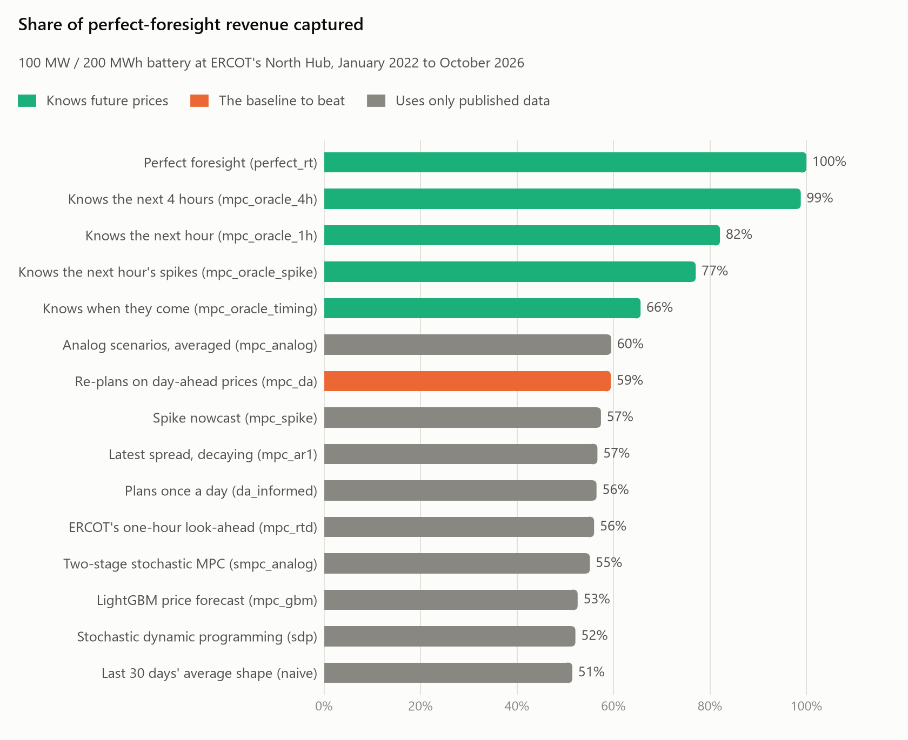
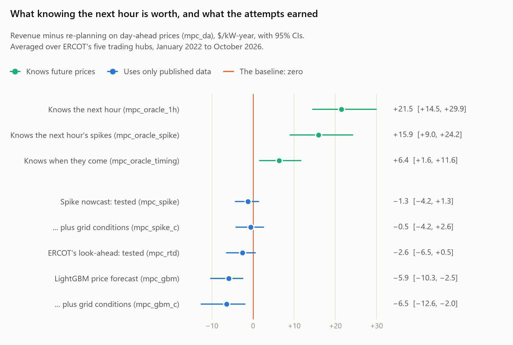
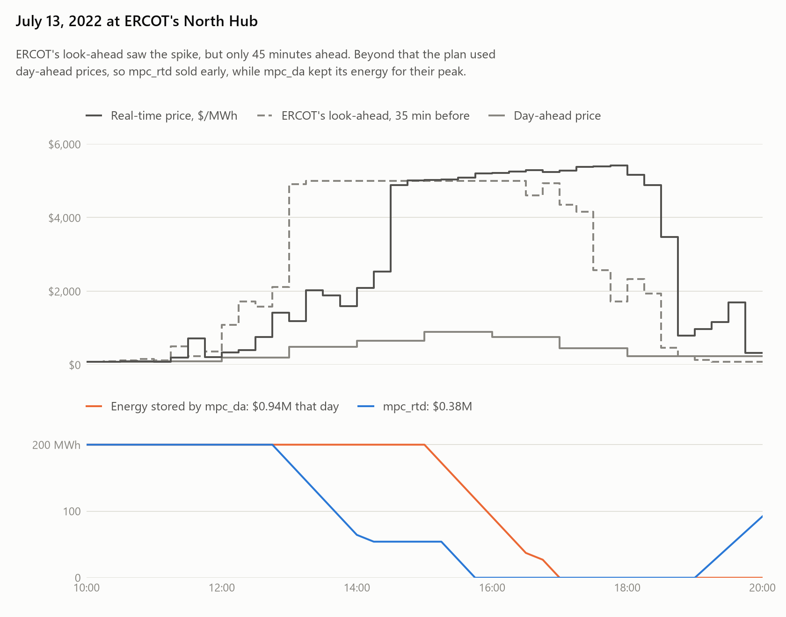

# Battery arbitrage on the Texas grid

[](https://github.com/chensirui3/Battery-arbitrage/actions/workflows/ci.yml)
[](https://battery-arbitrage-awxrrygki9tujwtm8jfx4n.streamlit.app/)

How much of a grid battery's theoretical arbitrage revenue in ERCOT can a realistic operator
actually capture, and where does the rest go?

This repo downloads ERCOT settlement point prices and forecasts real-time prices, both as single
values and as probability distributions. It dispatches a battery with planners that re-plan every
15 minutes, some of which plan explicitly for uncertainty. A backtest simulator lets each
decision, and each model fit, see only data that was public at the time.

## Findings at a glance

<picture>
  <source media="(prefers-color-scheme: dark)" srcset="docs/figures/capture-dark.png">
  
</picture>

- **Re-planning on day-ahead prices every 15 minutes captures 59%** of what perfect foresight
  earns at ERCOT's North Hub: $52 of $88/kW-year, January 2022 to October 2026. No realistic
  policy beat it detectably.
- **Almost all of the missing revenue is in the next few hours, mostly in price spikes.**
  Knowing the next 4 hours' real-time prices would capture 99%, and the next hour alone 82%.
  Averaged over ERCOT's five trading hubs, knowing the next hour is worth $21.5/kW-year more
  than re-planning on day-ahead prices. Knowing only its spikes, prices more than $100/MWh from
  day-ahead, is worth $15.9 of that.

<picture>
  <source media="(prefers-color-scheme: dark)" srcset="docs/figures/next-hour-dark.png">
  
</picture>

- **Three ideas for capturing it were each tested in a comparison fixed before it ran, and none
  was confirmed.** They were ERCOT's load, wind, and solar forecasts as model features;
  classifiers for spikes in the next hour; and ERCOT's own one-hour price look-ahead, with
  real-time reserves, dispatch prices, and outages. Averaged over the hubs, the spike nowcast
  earned −$1.3/kW-year [−4.2, +1.3] against re-planning on day-ahead prices, and the look-ahead
  −$2.6 [−6.5, +0.5].
- **Better forecasts did not mean more revenue.** Probabilistic forecasts cut the first hour's
  forecast error (CRPS) by up to 40% against day-ahead prices, and the spike classifier's ROC
  AUC is 0.96. Yet every planner that acted on information beyond day-ahead prices earned the
  same or less. Trading on small everyday edges pays about 15% in round-trip losses plus
  $10/MWh of wear each time.

<picture>
  <source media="(prefers-color-scheme: dark)" srcset="docs/figures/july-13-2022-dark.png">
  
</picture>

- **The failures share one shape.** A signal that sees one hour ahead, with day-ahead prices
  beyond it, makes the planner sell into the start of a long spike. On July 13, 2022, ERCOT's
  look-ahead saw the spike coming, so `mpc_rtd` sold most of the battery at $1,186–2,087/MWh.
  The price then stayed above $4,800 for four hours. What is missing is how long a spike will
  last.
- **Every decision sees only what was public at the time.** Each value is stored with the time
  it was published. Leakage tests replace everything published after a cutoff with noise and
  check that no earlier decision changes. The same check must catch the oracles.

The [write-up](docs/writeup.md) tells the story in one read, and the
[live dashboard](https://battery-arbitrage-awxrrygki9tujwtm8jfx4n.streamlit.app/) lets you
explore it. Each test fixed before running has its plan and dated outcome in [docs/](docs/).

## Dashboard

An interactive dashboard over the saved backtests,
[live on Streamlit Community Cloud](https://battery-arbitrage-awxrrygki9tujwtm8jfx4n.streamlit.app/)
([`dashboard/app.py`](dashboard/app.py)):

- **Overview:** each policy's share of perfect-foresight revenue, at any hub.
- **Compare policies:** any policy minus any baseline, at any set of hubs and over any period,
  with the same bootstrap CIs as `batt pool`. With all five hubs and the whole period it
  reproduces the numbers above, and a test checks that it does.
- **Revenue over time:** cumulative revenue, the monthly gap to the baseline, results by year,
  and the days that decide it.
- **A day in the market:** any day at `HB_NORTH`, interval by interval: real-time and
  day-ahead prices, ERCOT's look-ahead, and the energy each policy kept.
- **Forecasts:** CRPS by lead time for 14 forecasters, and the spike classifiers' skill.

It reads only `dashboard/data/` (2.8 MB, exported from the results by
`scripts/export_dashboard_data.py`), so it runs without the downloads, the backtests, or the
project's own solvers and models:

```bash
pip install -r dashboard/requirements.txt
streamlit run dashboard/app.py
```

The live app is deployed from `main` with `dashboard/requirements.txt`, and updates when `main`
changes.

## What's built

- data pipeline, battery optimizer, leakage-safe simulator, baseline strategies
- point forecasts (day-ahead, AR(1), LightGBM) and model-predictive control (MPC)
- probabilistic forecasts (analog ensembles, quantile LightGBM with conformal calibration)
- planning under uncertainty (stochastic MPC, stochastic dynamic programming)
- a value-of-information benchmark
- ERCOT fundamentals: every hourly load, wind, and solar forecast published since 2021, exactly
  as published, used as features for the price forecasts
- spike nowcasting: classifiers for price spikes in the next hour, judged by the revenue they add
  in a test fixed before running, at all five ERCOT trading hubs
- real-time grid conditions: ERCOT's dispatch prices, reserves, one-hour price look-ahead, and
  outages, every publication since 2021 with its publish time. Tested the same way, both as a
  forecast in their own right and as model features
- an interactive dashboard over the saved results ([above](#dashboard))

## Results

100 MW / 200 MWh battery at ERCOT's North Hub (`HB_NORTH`), January 2022 to October 2026
(1,765 operating days). Assumptions: 85% round-trip efficiency, $10/MWh degradation cost,
real-time energy arbitrage only.

| Policy | What it knows when it decides | $/kW-year | Capture | vs `mpc_da` (95% CI) |
|---|---|---:|---:|---|
| **Oracles** | | | | |
| `perfect_rt` | Realized RT prices, a month at a time | 88.0 | 100% | +35.7 [+26.3, +46.9] |
| `mpc_oracle` | Realized RT prices to the end of the published DA prices | 88.1 | 100% | +35.8 [+26.4, +46.9] |
| `mpc_oracle_4h` | Realized RT prices for the next 4 hours, DA prices after | 87.0 | 99% | +34.7 [+25.4, +45.7] |
| `mpc_oracle_1h` | Realized RT prices for the next hour, DA prices after | 72.3 | 82% | +19.9 [+12.8, +28.4] |
| `mpc_oracle_spike` | ... only where they are spikes (beyond DA ± $100/MWh), DA prices elsewhere | 67.8 | 77% | +15.5 [+8.4, +23.9] |
| `mpc_oracle_timing` | Which of the next hour's intervals spike, assuming a typical spike size | 57.8 | 66% | +5.4 [+0.5, +10.6] |
| `perfect_da` | Realized DA prices, settled at DA | 59.0 | 67% | +6.6 [−1.9, +16.4] |
| **Re-plan every 15 min from one forecast** | | | | |
| `mpc_da` | DA prices | 52.3 | 59% | — |
| `mpc_analog` | Average of the analog scenarios | 52.4 | 60% | +0.1 [−1.6, +1.8] |
| `mpc_spike` | DA prices, raised or lowered for the next hour by a spike nowcast while a spike is under way | 50.5 | 57% | −1.8 [−5.5, +1.5] |
| `mpc_spike_f` | ... whose classifiers also see ERCOT's load, wind, and solar forecasts | 51.3 | 58% | −1.1 [−4.2, +1.9] |
| `mpc_spike_c` | ... whose classifiers also see real-time grid conditions | 51.3 | 58% | −1.0 [−4.9, +2.3] |
| `mpc_ar1` | DA + latest RT–DA spread, decaying | 49.9 | 57% | −2.4 [−6.0, +0.5] |
| `mpc_rtd` | ERCOT's own one-hour price look-ahead where it is more than $100/MWh from DA, DA prices elsewhere | 49.3 | 56% | −3.0 [−7.3, +0.4] |
| `mpc_gbm` | LightGBM forecast | 46.3 | 53% | −6.0 [−10.4, −2.4] |
| `mpc_gbm_f` | LightGBM forecast that also sees ERCOT's load, wind, and solar forecasts | 45.0 | 51% | −7.4 [−14.3, −2.3] |
| `mpc_gbm_c` | LightGBM forecast that also sees real-time grid conditions | 45.1 | 51% | −7.2 [−13.9, −2.1] |
| `mpc_gbm_1h` | LightGBM forecast for the next hour, DA prices after | 48.2 | 55% | −4.1 [−6.6, −1.7] |
| **Plan for uncertainty** | | | | |
| `smpc_analog_4h` | Analog scenarios; one plan for the first 4 h, then one per scenario | 52.4 | 59% | +0.0 [−1.6, +1.8] |
| `smpc_analog_1h` | ... one plan for the first hour | 51.1 | 58% | −1.2 [−2.9, +0.6] |
| `smpc_analog` | ... one action, then one plan per scenario (two-stage) | 48.5 | 55% | −3.8 [−5.5, −2.3] |
| `smpc_analog_rt` | Same, scenarios start from the latest RT spread | 46.8 | 53% | −5.6 [−9.1, −2.5] |
| `sdp` | Stochastic dynamic programming, Markov model of the spread | 45.9 | 52% | −6.5 [−10.0, −3.0] |
| **Plan once a day** | | | | |
| `da_informed` | DA prices, published the day before | 49.7 | 56% | −2.6 [−3.2, −2.0] |
| `naive` | Average daily shape of the last 30 days | 45.3 | 51% | −7.0 [−10.4, −3.9] |

How to read the table:

- **$/kW-year** is revenue net of degradation.
- **Capture** is that revenue divided by `perfect_rt`'s.
- **CIs** come from a moving-block bootstrap over weekly blocks of daily revenue differences.
- **RT** is the real-time market; **DA** is the day-ahead market. The spread is RT minus DA.

| Capture by year | 2022 | 2023 | 2024 | 2025, to Dec 4 | Since RTC+B, to Oct 2026 |
|---|---:|---:|---:|---:|---:|
| `perfect_rt`, $/kW-year | 109.2 | 180.5 | 56.8 | 45.6 | 40.7 |
| `mpc_oracle_1h` | 77% | 88% | 86% | 77% | 66% |
| `mpc_oracle_spike` | 71% | 85% | 79% | 70% | 60% |
| `mpc_oracle_timing` | 59% | 70% | 74% | 65% | 52% |
| `mpc_da` | 59% | 57% | 70% | 67% | 52% |
| `mpc_analog` | 56% | 57% | 71% | 71% | 51% |
| `mpc_spike` | 49% | 58% | 72% | 63% | 51% |
| `mpc_spike_c` | 49% | 60% | 72% | 63% | 51% |
| `mpc_rtd` | 51% | 57% | 67% | 61% | 44% |
| `smpc_analog` | 51% | 52% | 68% | 65% | 48% |
| `sdp` | 51% | 49% | 65% | 58% | 46% |
| `mpc_gbm` | 36% | 56% | 70% | 58% | 48% |
| `mpc_gbm_f` | 28% | 55% | 70% | 63% | 54% |
| `mpc_gbm_c` | 29% | 57% | 72% | 57% | 50% |
| `da_informed` | 56% | 56% | 65% | 61% | 43% |

ERCOT redesigned its real-time market (RTC+B) on December 5, 2025. The last column starts there,
so no column mixes the two market designs.

Forecast accuracy (`batt forecast`) is measured out of sample.

- A forecast is issued every hour, covering the time from 5 minutes before an interval to the end
  of the published DA prices.
- Models are refit monthly, exactly as inside the backtest.
- Scores use the CRPS (continuous ranked probability score). It measures a whole predicted
  distribution in $/MWh, and lower is better. For a single-value forecast it equals the MAE, so
  every forecaster sits on one scale.

| CRPS, $/MWh, 2022–2026, by lead time | 0–1 h | 1–4 h | 4–12 h | 12–24 h | 24–36 h |
|---|---:|---:|---:|---:|---:|
| `da` (RT = DA price) | 21.6 | 21.6 | 21.6 | 27.0 | 32.3 |
| `ar1` | 17.6 | 21.6 | 22.3 | 27.2 | 32.4 |
| `gbm` | 19.3 | 21.2 | 22.5 | 28.0 | 34.5 |
| `analog` (20 scenarios) | 16.4 | 16.4 | 16.3 | 20.1 | 24.2 |
| `analog_rt` (20 scenarios) | 13.2 | 16.1 | 16.4 | 20.1 | 24.2 |
| `qgbm` (5 calibrated quantiles) | 13.0 | 14.8 | 16.0 | 20.1 | 24.4 |
| `spike` (DA, moved for the next hour by the spike nowcast) | 19.6 | 21.6 | 21.6 | 27.0 | 32.3 |
| **With ERCOT fundamentals** | | | | | |
| `gbm_f` | 20.0 | 21.4 | 22.6 | 28.2 | 34.5 |
| `qgbm_f` | 13.2 | **14.7** | **15.7** | **19.8** | **24.1** |
| `spike_f` | 19.7 | 21.6 | 21.6 | 27.0 | 32.3 |
| **With real-time grid conditions** | | | | | |
| `gbm_c` | 18.6 | 21.1 | 22.3 | 27.7 | 34.2 |
| `qgbm_c` | **12.5** | **14.7** | 15.9 | 19.9 | **24.1** |
| `spike_c` | 19.6 | 21.6 | 21.6 | 27.0 | 32.3 |
| `rtd` (DA, except where ERCOT's look-ahead is more than $100/MWh away) | 26.9 | 21.6 | 21.6 | 27.0 | 32.3 |
| `rtd_all` (ERCOT's look-ahead as published, DA beyond it) | 25.9 | 21.6 | 21.6 | 27.0 | 32.3 |

ERCOT's look-ahead covers the next three 15-minute intervals. Over the first hour it scores worse
than DA prices. It looks worse still here because forecasts are issued on the hour, and from 2025
on its errors are largest in intervals that start on the hour ([why](docs/grid-conditions.md)).

How often the realized price falls inside each forecast's central 50% and 80% ranges:

| Forecaster | Inside the central 50% | Inside the central 80% |
|---|---:|---:|
| `qgbm` | 51–52% | 83–84% |
| `qgbm_f` | 50–52% | 83–84% |
| `qgbm_c` | 50–52% | 83–84% |
| `analog` / `analog_rt` | 42–44% | 70–71% |

The fundamentals models at every ERCOT trading hub, January 2024 to October 2026 (the check is
described under "What stands out"):

| $/kW-year | `HB_NORTH`* | `HB_WEST` | `HB_SOUTH` | `HB_HOUSTON` | `HB_PAN` |
|---|---:|---:|---:|---:|---:|
| `perfect_rt` | 48.0 | 54.5 | 44.0 | 43.3 | 53.0 |
| `mpc_da` | 30.6 | 35.0 | 27.3 | 26.1 | 32.0 |
| `mpc_gbm` | 29.0 | 34.9 | 27.3 | 26.9 | 30.9 |
| `mpc_gbm_f` | 30.6 | 34.7 | 27.4 | 26.4 | 32.4 |
| `mpc_gbm_f` − `mpc_gbm` (95% CI) | +1.6 [0.0, +3.2] | −0.2 [−2.0, +1.2] | +0.1 [−0.8, +0.9] | −0.5 [−1.6, +0.5] | +1.5 [+0.1, +3.2] |

\* The 2024–2026 part of the main backtest, where the lead was found. The other hubs are
separate runs starting on 2024-01-01; their models are the same as a longer run's would be,
since each refit sees only the two years before it.

### What stands out

- **Almost all the missing revenue is in the next few hours.** Re-planning on DA prices captures
  59%.
  - Perfect knowledge of RT prices for just the next 4 hours, with DA prices after, captures 99%.
  - Perfect knowledge for the next hour alone captures 82%, worth $20/kW-year.
  - The gap is mostly price spikes. Knowing only the next hour's spikes (RT more than $100/MWh
    from DA) is worth $15.5 of those $20, and $15.9 of $21.5 averaged over the five trading
    hubs. Knowing only when they come, with a typical size, is worth $5.4. From 2024 on,
    spikes carry less of it: $3.8 of $8.0 across the hubs.
- **Probabilistic forecasts are much better than the DA price by proper scores.**
  - Quantile LightGBM cuts CRPS by 40% in the first hour and by 25–30% further out. With
    conformal calibration, its ranges hold about as much of the outcome as they should.
  - Analog ensembles score almost as well, but are overconfident: 71% of prices fall inside the
    80% range. The 20 most similar past days vary less than reality.
- **No planner turned better forecasts into more revenue.** Every way of acting on information
  beyond the DA price earned the same or less than `mpc_da`:
  - **Two-stage stochastic MPC** (`smpc_analog`, 55%). It fixes the next 15 minutes for all
    scenarios and then plans each scenario separately. Each scenario's plan therefore acts as if
    it knew that scenario's whole future 15 minutes from now. It holds energy for spikes it could
    never time, since prices arrive 25 minutes late.
  - **Sharing the plan for longer** removes that false foresight: 58% when shared for one hour,
    59% for four hours. That is about what the plan on the average scenario earns (`mpc_analog`,
    60%), which ties `mpc_da`.
  - **Stochastic dynamic programming** (`sdp`, 52%). It models what the battery will actually
    learn and when: it reacts to a spike only after it would be published. It still buys at
    higher prices than `mpc_da` ($28.7 vs $20.7/MWh).
  - **Point-forecast MPC with recent RT prices** (`mpc_ar1`, `mpc_gbm`) and anchored scenarios
    (`smpc_analog_rt`) did worse than ignoring them.

  The forecasts beat the DA price on average, mostly on small everyday deviations. A planner that
  trades on those small edges pays about 15% in round-trip losses plus $10/MWh of wear each time.
  None of these models predicts when a spike will start or how high it will go. That is what
  the one-hour oracle knows.
- **ERCOT's own load, wind, and solar forecasts did not close the gap.** The comparison was fixed
  before the history was downloaded: the same LightGBM settings plus ten fundamentals features
  ([which](docs/fundamentals.md)).
  - Forecasts barely changed. Quantile LightGBM's CRPS improved by up to 2% beyond the first
    hour and got slightly worse within it. The point model got slightly worse, most in the
    first hour (MAE 19.3 → 20.0).
  - Revenue did not change detectably. `mpc_gbm_f` earned $1.3/kW-year less than `mpc_gbm`
    (95% CI [−4.6, +1.3]).
  - The model does use the new features: they carry about 20% of its learned gain, mostly the
    net-load and wind levels and how they moved after the bid deadline. But the DA price
    already reflects ERCOT's forecasts as of the bid deadline. Only later revisions are news
    to it, and here they added little.
  - One week accounts for the whole shortfall: the heat wave of July 8–13, 2022, when ERCOT set
    demand records. `mpc_gbm_f` fell $643k behind `mpc_gbm` that week, against $635k over the
    whole backtest. Over July 2022, `mpc_gbm_f` made $0.5M, `mpc_gbm` $1.3M, `mpc_da` $2.4M.
  - Why: in 2022 the models had only 2021 onward to learn from (the price history starts
    there), including Winter Storm Uri. From it they learned that RT clears far below DA
    whenever DA is high. On the heat wave's peak afternoons, the DA price alone pulled
    `gbm_f`'s forecast $200–340/MWh below DA. The load forecasts, near 78 GW, pulled it another
    $45–50/MWh lower; training had seen that level on only four days, all in June 2022. RT
    came in above DA on most of those afternoons, so the battery saved too little energy for
    the peaks.
  - A lead from 2024 on did not hold up at the other hubs. At `HB_NORTH`, `mpc_gbm_f` beat
    `mpc_gbm` by $1.6/kW-year [0.0, +3.2] from 2024 on, but that cut was chosen after seeing
    the results. So it was tested at the other four trading hubs, with the test fixed before
    running: the difference averaged over the hubs day by day, CIs from resampling the same
    weeks at every hub, confirmed only if the 95% CI is above zero. The result is
    +$0.2/kW-year [−0.6, +1.0], so it is not confirmed. Only `HB_PAN` came out positive on its
    own; one hub in four doing that is not unusual by chance alone. ([table](#results))
  - From 2024 on, when every model trains on two full years, neither LightGBM policy differs
    detectably from `mpc_da` at any of the five hubs. They match re-planning on DA prices, at
    the cost of a model.
- **A classifier that predicts spikes well did not add revenue either.** The test was fixed
  before running ([plan](docs/spike-nowcasting-plan.md)): `mpc_spike` minus `mpc_da`, January
  2022 to October 2026, averaged over the five trading hubs, confirmed only if the 95% CI is
  above zero.
  - The classifier has real skill. For up-spikes in the next hour, its ROC AUC is 0.96 and its
    average precision 0.34 (1% of intervals spike). A model that sees only what the DA prices
    knew scores 0.86 and 0.06.
  - Revenue: −$1.3/kW-year [−4.2, +1.3], so not confirmed. From 2024 on: +$0.0 [−1.1, +1.2].
  - A few extreme days decide it. Acting on a spike already under way pays when the spike comes
    apart from the DA peak. It costs when the spike builds into the DA peak: the battery sells
    into the early part and has too little left for the top. The forecast also sits far below
    the price that follows, since it knows a spike's odds but not its size
    ([details](docs/spike-nowcasting.md)).
- **ERCOT's own one-hour price look-ahead lost to the DA plan.** This test was also fixed before
  running ([plan](docs/grid-conditions-plan.md)): `mpc_rtd` minus `mpc_da`, averaged over the
  five hubs, confirmed only if the 95% CI is above zero. How to use the look-ahead was chosen on
  July to December 2021.
  - Revenue: −$2.6/kW-year [−6.5, +0.5], so not confirmed. From 2024 on it is
    −1.8 [−3.5, −0.2], and since RTC+B −2.6 [−4.8, −0.8]: the look-ahead cost money.
  - Its big up-moves seldom came true. Where it put an interval more than $100/MWh above DA,
    the price got there 16–39% of the time, depending on the year. It came in far lower on
    average: in 2026 the look-ahead said +$725 and the price came in at +$53.
  - When a spike was real, a one-hour view made the planner sell too early. July 13, 2022 holds
    42% of the loss. From 12:45 the look-ahead showed $1,257–5,001/MWh for the next 45 minutes,
    and a spike did come. With DA's $487–891 beyond that, `mpc_rtd` sold most of the battery at
    $1,186–2,087. The price then stayed above $4,800 for four hours.
  - As model features, reserves, dispatch prices, the look-ahead, and outages carry 8–20% of
    the models' learned gain. They improve the spike classifier (up-spike average precision
    0.34 → 0.44) and the forecasts a little (first-hour CRPS 13.0 → 12.5). In revenue,
    `mpc_spike_c` minus `mpc_spike` is +0.7 [−0.2, +1.7] and `mpc_gbm_c` minus `mpc_gbm` is
    −0.6 [−2.9, +1.3] ([details](docs/grid-conditions.md)).
- **Re-planning on DA prices is still the policy to beat.** No realistic policy has beaten it
  detectably. It beats the once-a-day plan by $2.6/kW-year, in every year.
  - The daily plan has to be back at 50% SoC at midnight, so it recharges in the late evening.
  - Once tomorrow's DA prices post at 13:30, the rolling horizon sees past midnight and carries
    over only the energy that pays.
- **Arbitrage value fell sharply after 2023.** Even with perfect foresight, this battery would
  have earned $180/kW-year in 2023 but $41–57 a year from 2024 on. Texas added gigawatts of
  batteries and solar over this period, which compresses the spreads batteries trade on. Revenue
  is also concentrated: the 10 best days out of 1,765 carry 23% of perfect-foresight revenue.
- **The months since ERCOT's real-time market redesign (RTC+B, December 5, 2025) are the
  hardest so far** for most realistic policies. For `mpc_gbm`, `mpc_gbm_f`, `mpc_gbm_c`,
  `mpc_spike`, and `mpc_spike_c` it is 2022. Even the one-hour oracle drops to 66%. Why is not
  yet explained.

The value-of-information result sets the direction. The missing revenue is in the next few
hours, mostly in spikes: how high they go and how long they last, as well as when they start.
Price history predicts whether a spike is coming in the next hour, but not its size, and acting
on that did not pay. Neither ERCOT's load, wind, and solar forecasts nor its real-time grid
conditions changed that. ERCOT's own look-ahead sees a spike coming, but only an hour ahead, so
a planner that trusts it sells before the peak. The open question is how long a spike will last
([future work](#future-work)).

An earlier finding still holds. Winsorizing LightGBM's training labels at ±$1,000/MWh biases its
forecasts low in exactly the spike-prone afternoon hours. Turning winsorizing off made it noisier
and worse: $42.4/kW-year (`label_clip: null`).

## How it works

The information timeline is the central design decision. Every value is stamped with when it
became public, and each decision sees only what was published by then:

| When (Central time) | Newly public | Decision |
|---|---|---|
| Day before, 10:00 | | Day-ahead bids for day D (DA strategies only) |
| Day before, ~13:30 | Day-ahead prices for day D | |
| Every hour | Outage capacity for each hour of the coming week | |
| Every 5 min | The dispatch run's system price and reserves (seconds after it runs); ERCOT's look-ahead prices for the next 55 minutes, two hours from August 27, 2026 (about 15 seconds after) | |
| 5 min before each 15-min interval | RT prices of intervals that ended at least 5 min ago | Charge/discharge for that interval (MPC policies re-plan here) |

The code is organized as follows:

- `batt.data.store` holds point-in-time tables.
  - A `DataView` as of time *t* hides everything published after *t*.
  - Only oracle benchmarks get an unrestricted view.
  - Time windows are found by binary search, which keeps the ~170,000 queries per backtest fast.
- `batt.data.fundamentals` stores ERCOT's hourly load, wind, and solar forecasts by publication.
  A view returns the forecast that was current at any given moment, such as now or the DA bid
  deadline ([details](docs/fundamentals.md)).
- `batt.data.conditions` stores ERCOT's real-time grid conditions by publication: the dispatch
  run each decision would see, the look-ahead run, and hourly outage capacity
  ([details](docs/grid-conditions.md)).
- `batt.forecast` holds the RT price forecasters. They see only point-in-time views:
  - Point forecasts: `da` (the DA price) and `ar1` (the DA price plus the latest RT–DA spread,
    decaying at a fitted AR(1) rate).
  - `gbm` is LightGBM on the RT–DA spread with 21 point-in-time features. It is refit at the start
    of each month inside the backtest, on the two years of data public at that moment. `gbm_f`
    and `qgbm_f` add ten fundamentals features ([below](docs/fundamentals.md)).
  - `qgbm` is quantile LightGBM. It fits one model per quantile with pinball loss. Each quantile is
    then shifted using the last 60 days of each training window, separately by lead time, so that
    it is calibrated (split-conformal calibration).
  - `analog` takes today's DA prices and adds the RT–DA spread paths of the 20 past days whose DA
    prices looked most similar. These are real spike shapes, at the same local times.
  - `analog_rt` shifts each of those paths to start from the spread just observed.
  - `spike` is the next-hour spike nowcast. Two LightGBM classifiers give, for each interval of
    the next hour, the probability that RT ends up more than $100/MWh above or below DA. They
    see `gbm`'s features plus recent spike frequencies and are refit monthly like `gbm`. While
    the latest published price is itself a spike, the next hour's forecast is DA plus that
    side's probability times its typical size in the training window. Otherwise, and after
    the next hour, the forecast is DA ([details](docs/spike-nowcasting.md)).
  - `rtd` (`batt.forecast.lookahead`) is ERCOT's own look-ahead. For each of the next hour's
    intervals that the latest run covers fully, it uses the look-ahead's price where that is
    more than $100/MWh from DA, and DA elsewhere. `gbm_c`, `qgbm_c`, and `spike_c` add six
    grid-conditions features ([below](docs/grid-conditions.md)).
  - `batt forecast` runs the walk-forward evaluation (MAE, RMSE, CRPS, coverage). `batt nowcast`
    scores the spike classifiers (ROC AUC, average precision, Brier skill, reliability).
- `batt.optimize` holds the solvers.
  - `lp` is the battery LP (HiGHS) with a MILP fallback for simultaneous charge/discharge.
  - `rolling` keeps one warm-started HiGHS model for MPC: about 0.45 ms per re-plan instead of
    2.7 ms.
  - `scenario` is the stochastic LP. One plan is shared by all scenarios for a first stretch,
    then each scenario gets its own. Steps are 15 minutes for 4 hours, then hourly.
- `batt.policies` holds the policies:
  - oracles and daily-plan baselines
  - `mpc_*`: re-plan from a point forecast, including `mpc_spike` on the spike nowcast and
    `mpc_rtd` on ERCOT's look-ahead
  - `mpc_oracle_spike`, `mpc_oracle_timing`: the next hour's spikes known in advance, with or
    without their size
  - `smpc_*`: re-plan against scenarios
  - `sdp`: stochastic dynamic programming. Its state is stored energy plus the spread state of
    the latest published price. Spreads follow a Markov chain by hour of day, fitted monthly. It
    builds a value table once a day and makes each decision by lookup.
- `batt.sim.simulator` is one engine for every policy.
  - It enforces battery physics.
  - It settles DA positions at DA prices and deviations at RT prices.
  - It writes a per-interval ledger.
- `batt.evaluate` computes $/kW-year, capture rate, cycles, average prices, and bootstrap CIs. It
  also values the energy left in the battery at the end, so policies that end at different SoCs
  are comparable. `batt pool` averages saved backtests over several hubs day by day. Its CIs
  resample the same weeks at every hub, since hubs share weather and scarcity events. Tables by
  year keep the days from RTC+B (December 5, 2025) on apart.

**Leakage tests.** `tests/test_leakage.py` replaces every value published after a cutoff with
random noise and re-runs each policy.

- Real-time decisions and day-ahead bids made before the cutoff must not change.
- The same check must *fail* for the oracles, which shows it can detect leakage.
- Models train inside the simulation from the same point-in-time view. One test refits LightGBM
  daily, both the price forecaster and the spike classifiers, so training on the cutoff day and
  after it is covered too.

Feature, analog-scenario, and training-set tests check the same property directly.

## Quickstart

Requires Python 3.11+.

```bash
python -m venv .venv
source .venv/bin/activate          # Windows: .venv\Scripts\activate
pip install -e ".[data,dev]"
batt ingest     # ERCOT hub/zone prices for 2021-2026 (~5 min, mostly Excel parsing)
batt validate   # every day complete (96 intervals; 92/100 on DST days), no gaps or duplicates
batt backtest   # 22 policies, Jan 2022 - Oct 2026 (~40 min on 16 cores, policies in parallel)
batt forecast   # walk-forward accuracy of 15 forecasters, same period (~55 min)
batt nowcast    # skill of the spike classifiers at every decision, same period (~7 min)
pytest          # 152 tests, ~2 min, offline (synthetic data, and the dashboard's own)
```

Policies and forecasters that need fundamentals (`mpc_gbm_f`, `mpc_spike_f`, `gbm_f`, `qgbm_f`,
`spike_f`) are skipped, with a note, until fundamentals covering the backtest period have been
ingested ([setup](docs/fundamentals.md#setup)). The same goes for those that need grid conditions (`rtd`, `rtd_all`, `gbm_c`,
`qgbm_c`, `spike_c`) and `batt ingest-conditions`. The grid-conditions policies (`mpc_rtd`,
`mpc_gbm_c`, `mpc_spike_c`) are not in the default backtest; name them with `--policies`.

Run a different period, location, or set of policies:

```bash
batt backtest --location HB_WEST --start 2024-01-01 --end 2025-01-01 --policies perfect_rt,mpc_da,da_informed
```

Once every trading hub has a run for the same period, compare policies across all five:

```bash
batt pool --policies mpc_spike --baseline mpc_da
```

Every assumption lives in [`configs/default.yaml`](configs/default.yaml), including forecaster
settings. Named variants of a policy go there too, e.g. `mpc_oracle_1h` is `mpc_oracle` with
`forecaster_params: {hours: 1}`. Each run writes `results/<location>_<start>_<end>_<config hash>/`,
containing:

- the config snapshot
- summary tables by year and month
- per-interval ledgers (Parquet)

`batt forecast` writes `results/forecast_.../` and `batt nowcast` writes `results/nowcast_.../`.
Use `batt ingest --year 2026 --force` to refresh the current year.

The README figures come from `python scripts/make_figures.py` (`pip install -e ".[figures]"`),
once the backtests behind them are saved in `results/`.

## Deep dives

- [Why nothing beat re-planning on day-ahead prices](docs/writeup.md): the whole project in one
  read.
- [Fundamentals data](docs/fundamentals.md): ERCOT's load, wind, and solar forecasts, every
  publication since 2021, and the free ERCOT API account its downloads need.
- [Spike nowcasting](docs/spike-nowcasting.md): classifiers for price spikes in the next hour,
  and why their skill did not become revenue.
- [Real-time grid conditions](docs/grid-conditions.md): ERCOT's dispatch prices, reserves,
  one-hour price look-ahead, and outages, and why the look-ahead lost.
- [Plans fixed before running](docs/), each with its dated outcomes:
  [spike nowcasting](docs/spike-nowcasting-plan.md),
  [grid conditions](docs/grid-conditions-plan.md).

## Data notes

- **Source:** ERCOT's yearly hub and load-zone price files.
  - Report 13061 is real-time (15-minute); report 13060 is day-ahead (hourly).
  - Raw zips are kept unchanged in `data/raw/` under ERCOT's file names, which include the publish
    time.
- **Parsing** reuses [gridstatus](https://github.com/gridstatus/gridstatus) for ERCOT's
  hour-ending and daylight-saving conventions. Everything is stored in UTC.
- **Load zones:** gridstatus's `get_rtm_spp` merges each load zone's plain price with its
  energy-weighted price (`LZ` and `LZEW`). It looks for a `SettlementPointType` column, but the
  yearly files call it `Settlement Point Type`. This project renames the column before parsing,
  so energy-weighted zones are kept separately as `LZ_*_EW`.

## Assumptions and current limitations

- The battery is a price-taker. Only real-time energy arbitrage is modeled (no ancillary services
  yet).
- Timing:
  - RT prices are visible 5 minutes after their interval ends.
  - Actions are committed 5 minutes before their interval starts.
  - DA prices post at 13:30 the day before.
- No fees, outages, or auxiliary loads. Degradation is a flat cost per MWh discharged.
- SoC targets:
  - `perfect_rt` is solved one calendar month at a time and returns to 50% SoC at each month's
    end.
  - The daily plans return to 50% every midnight.
  - The MPC and SDP policies return to 50% at the end of their horizon.
- The stochastic planners use simplifications:
  - Scenario plans may charge and discharge in the same step at deeply negative prices. Only the
    net first action is executed. Physics clipped 3 of 169,000 requests for `smpc_analog_rt`.
  - Neither stochastic planner models a daily cycle cap; both refuse a config that sets one.
  - `qgbm` scenarios are evenly spaced quantiles. They are good for scoring each interval, but
    they are not a model of how errors evolve over time, so no planner uses them.
- Forecaster and planner settings were fixed before running the backtest, with no tuning on its
  results. Two exceptions are reported alongside the defaults:
  - LightGBM without label winsorizing
  - the shared-plan length of stochastic MPC

  The fundamentals comparison was also set in advance. Its 2024-onward split was post hoc, so it
  was then tested at the other hubs with the test fixed before running.

  The spike nowcast's one open choice, how probabilities become prices, was made on July to
  December 2021, before the backtest period. Its test was then fixed in writing and run once
  ([plan](docs/spike-nowcasting-plan.md)). The grid-conditions test followed the same pattern:
  its two open choices were made on July to December 2021, and the test was fixed in writing and
  run once ([plan](docs/grid-conditions-plan.md)).
- The price history starts in 2021, so the forecasters' training windows in 2022 hold only 12–24
  months, including Winter Storm Uri (February 2021).
- Runtime: LightGBM uses every core. When policies run in parallel, its training competes with
  the other processes.

## Future work

1. **How high and how long a spike will go.** The spike nowcast and ERCOT's look-ahead both
   failed on exactly that. Each sees at most an hour ahead, with DA prices beyond it, so the
   planner sells into the start of a long spike. Every test so far ran on 2022–2026, so a fair
   test of a new model needs data it has not touched: the months after October 2026, or the
   years before 2021.
2. **Other signals:** weather forecasts and gas prices.
3. **A longer price history,** so the 2022 models have more than a year to learn from. ERCOT's
   price files go back further, and its archive of load, wind, and solar forecasts goes back to
   at least 2019.
4. **Decision-focused learning:** train forecasters on the revenue their dispatch earns, not on
   MAE. Better forecasts by MAE and CRPS never earned more here.
5. **Other batteries:** how the results change with battery duration and efficiency.

## Layout

```
configs/default.yaml   every modeling assumption: battery, timing, policies, forecasters
src/batt/
  data/        ERCOT prices, fundamentals, and real-time grid conditions (download, parsing,
               point-in-time storage), validation, synthetic data
  forecast/    price history grid, features, point / quantile / analog forecasters,
               next-hour spike nowcast, ERCOT's look-ahead,
               Markov spread model, walk-forward evaluation (MAE, RMSE, CRPS, coverage)
  optimize/    battery LP / MILP, warm-started MPC solver, stochastic (scenario) LP
  policies/    oracles, daily plans, MPC, stochastic MPC, stochastic dynamic programming
  sim/         calendar, decision contexts, simulator
  evaluate/    metrics, bootstrap, period tables, averages across hubs
  cli.py       batt ingest | ingest-fundamentals | ingest-conditions | validate | backtest |
               forecast | nowcast | pool
dashboard/     Streamlit app (app.py), its statistics (bundle.py), and the compact data it reads
scripts/       make_figures.py, export_dashboard_data.py: README figures and dashboard data,
               from saved results
docs/          the write-up, deep dives, plans written before running, figures
tests/         optimizer, data, forecasting, scenarios, MPC, simulator, leakage, CLI (offline)
```

## License

MIT. See [LICENSE](LICENSE).
